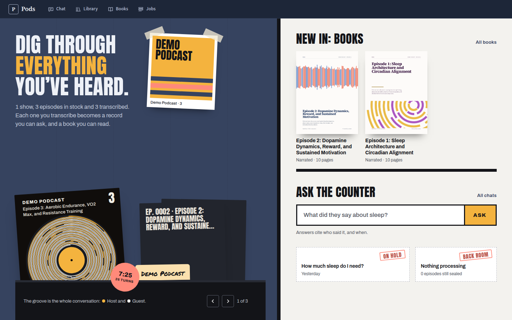
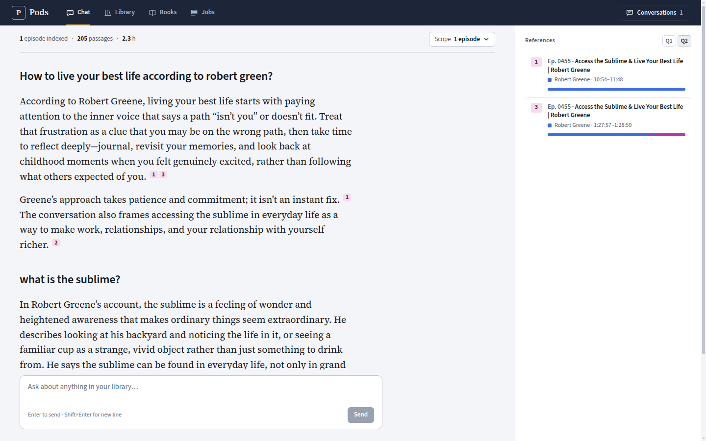
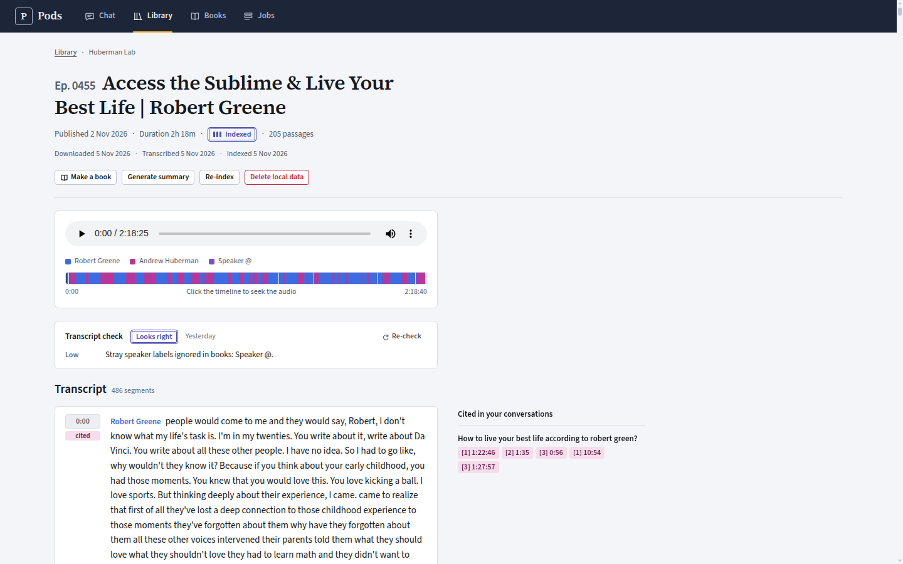
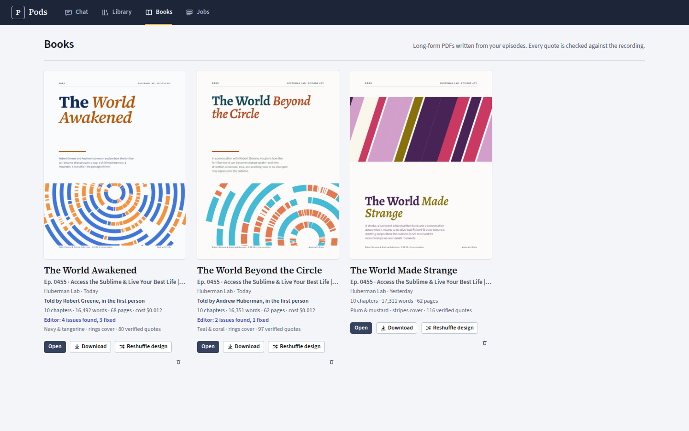

# Pods: podcast library chat

A local RAG chatbot over podcast episodes. Add any podcast by name or RSS feed, and Pods downloads its episodes, transcribes them **with per-speaker diarization** and indexes them into a persistent local vector store. Then you can ask the whole library questions, and every answer cites the episode, who said it, and when. Any transcribed episode can also become a long-form PDF book.

**Build once, ask forever.** Everything is saved under `./data`: audio, transcripts, summaries, books, the Chroma index and chat history. The next time you open the site the chatbot is ready at once, and new episodes extend the same index.



## A tour

- **Home.** Your library as a record shop. Transcribed episodes are sleeves in a crate, each one's art the whole conversation drawn as a record groove coloured by speaker (flip with the arrows or arrow keys). Episodes not yet transcribed are sealed sleeves, and each podcast is a hand-lettered divider card. The wall carries the shows' artwork as duotone posters and a daily "staff pick", a verified quote from one of your books. The counter shows your newest books, the ask field, your last chat and any running job. *(The screenshot above uses the free demo library.)*
- **Library.** Find podcasts by name in the Apple Podcasts directory or by genre chart, or paste an RSS URL. Search and select episodes, and process them after a cost confirmation.
- **Chat.** Answers are set as serif prose with numbered citations; the references column lists each passage with its episode, speaker and timestamps. Narrow the scope to one podcast or a few episodes. A citation jumps to that moment in the episode.

  

- **Episode.** Audio player with a seekable speaker timeline, the diarized transcript, an optional summary, an automatic transcript check, and the conversations that cited this episode.

  

- **Books.** Long-form PDF books written from an episode, told by a narrator or by one of the speakers. See [Books](#books).

  

- **Jobs.** The background queue (download, transcribe, index, books) with live progress, the measured cost of each job, cancel and retry.

## Quick start (Docker)

```bash
cp .env.example .env        # add OPENAI_API_KEY (and OPENROUTER_API_KEY if you use it)
docker compose up --build   # add -d to run in the background
```

Then open **http://localhost:8080**.

1. **Library → Browse podcasts**: search for a show by name (Huberman Lab is the suggested default) and add it, or paste an RSS URL.
2. Search its episodes (e.g. `essentials`), select some (or *Select all matching*), then click *Process*.
3. A confirmation dialog shows the episode count, minutes and **estimated cost**. Nothing paid runs before you confirm.
4. Follow progress in **Jobs**. Each episode becomes askable as soon as it is indexed.
5. **Chat**: ask anything, or use the ask field on the home page.

`./data` is a bind mount, so it survives `docker compose down` and rebuilds. The backend runs as whoever owns `./data` on the host, so those files stay yours.

## Local development

```bash
./dev install      # uv sync + npm install
./dev backend      # API on :8000 (reload), data in ./data
./dev frontend     # Vite on :5173, proxies /api to :8000
./dev test         # offline backend tests + frontend build
./dev lint         # ruff + oxlint
```

### Free demo mode (no keys, no network, no cost)

```bash
./dev seed-demo    # writes a fictional "Demo Podcast" with diarized transcripts to ./data-demo
./dev demo         # API in fake mode against ./data-demo
./dev frontend     # then open http://localhost:5173
```

Fake mode (`LLM_PROVIDER=fake TRANSCRIBER=fake EMBEDDINGS_PROVIDER=fake DOWNLOAD_MODE=fake`) swaps every paid provider for a deterministic local stand-in, books included. The test suite always runs this way.

## Architecture

```
browser ── nginx (frontend :8080) ──/api──▶ FastAPI (backend :8000)
                                            ├─ SQLite  data/app.db        podcasts, episodes, jobs, chats, books
                                            ├─ Chroma  data/chroma/        passage embeddings
                                            ├─ files   data/podcasts/…     audio, transcript.json/.md, summary.md, books/<id>/book.pdf
                                            └─ job worker  download → transcribe → index · summarize · write book
```

| Concern | Choice |
|---|---|
| Backend | FastAPI, SQLModel/SQLite, ChromaDB, Python 3.12, managed with **uv** |
| Frontend | React + Vite + TypeScript, managed with **npm**, served by nginx |
| Transcription | OpenAI `gpt-4o-transcribe-diarize` (speaker-labelled segments), with fallback `gpt-transcribe` + LLM speaker attribution |
| Embeddings | OpenAI `text-embedding-3-small` |
| Chat, summaries, books | `gpt-6-luna` via **OpenAI or OpenRouter** (`LLM_PROVIDER`) |
| Book typesetting | WeasyPrint (HTML/CSS to PDF), with bundled open fonts |

There's no Hugging Face, no local models and no GPU. Contracts, endpoints and module ownership are in [`docs/architecture.md`](docs/architecture.md); the visual system is in [`DESIGN.md`](DESIGN.md). The original notebooks are kept in [`notebooks/legacy/`](notebooks/legacy).

## Books

Open a transcribed episode and choose **Make a book**. Pods plans chapters from the whole conversation and writes each section from its own stretch of the transcript; a 2-hour episode becomes roughly 9–11 chapters and 15–20k words. Every quote is checked word for word against the recording and footnoted with its timestamp. An editor pass then compares the narration with the transcript (who said what, numbers, overstatement, repetition, invented material) and rewrites only the sections it flags. Each book gets its own design: one of 8 colour families, 4 font pairings and 8 kinds of cover art, several drawn from the conversation itself. **Reshuffle design** gives the same text a new look for free.

**Who tells it.** By default a third-person narrator retells the conversation, like a magazine feature. You can instead pick one of the speakers, usually the host (Pods guesses who that is from the podcast's name, or from who asks the questions). The book is then told in their first person, looking back on the conversation. Their side of the story comes only from what they actually said: the writer is told never to invent memories, feelings or opinions, the editor flags any it finds, and other speakers' ideas stay credited to them. The PDF says the voice was written by AI from the episode, not by that person.

A book costs about one or two cents with `gpt-6-luna`.

## How transcription works

Episodes are re-encoded and split into ~10-minute chunks, since the API limit is 25 MB per file. Chunk 1 is diarized on its own. Then a 2–10 s reference clip is cut for each detected voice and passed to every later chunk as `known_speaker_references`, so the same person keeps the same label across the whole episode; the later chunks run in parallel. A single LLM call maps the labels to names using the episode title and description.

Every transcription then gets an automatic check, shown on the episode page: gaps, a transcript that ends early, repeated-text loops, one voice holding nearly everything, stray noise labels, and a quick confirmation of the speaker names (a confident swap is corrected).

## Costs and models

- **Transcription is the main cost.** `gpt-4o-transcribe-diarize` is billed by tokens, and speaker-labelled output is token-heavy (about 11 output tokens per spoken word), so it costs about **$0.02 per audio minute**, roughly $2.50–3 for a 2-hour episode. That is well above the $0.006/min OpenAI lists as its estimate.
- **Costs are measured, not just estimated.** Every paid call records the usage OpenAI billed for it. Jobs show their real cost, episodes show what their transcription cost, and books show their writing cost. Once one real transcription has been measured, estimates use your measured per-minute rate instead of the configured price. Prices live in `.env` / `app/config.py` (`PRICE_*`); check them against current OpenAI pricing.
- **Cheaper transcription:** `TRANSCRIBER=openai_text` uses `gpt-transcribe` ($0.0045/min) with an LLM inferring speaker turns, at the cost of less reliable speaker labels.
- Embeddings, chat, summaries and books are cheap in comparison. Summaries are optional and generated per episode on demand. Home page posters are made locally from the feed artwork, with no model calls.
- **Nothing is redone.** Re-processing skips anything already downloaded, transcribed or indexed. *Rebuild index* re-embeds from the transcripts on disk and never re-transcribes.
- **Model sunset:** OpenAI shuts down `gpt-4o-transcribe-diarize` on **2027-02-26**. Before then, switch to `TRANSCRIBER=openai_text` or to a newer diarizing model through `DIARIZE_MODEL`.

## Privacy

Everything is stored on your machine. Network calls go to OpenAI (or OpenRouter) for audio chunks to transcribe, transcript text to embed, and the passages and questions needed for chat, summaries and books; to each podcast's own servers for its feed, audio and artwork; and to the Apple Podcasts directory when you search for a show. The app is a single-user local tool with no authentication; don't expose it beyond localhost.
